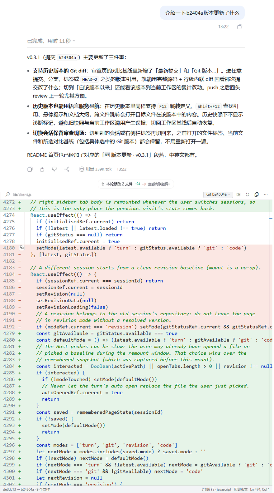
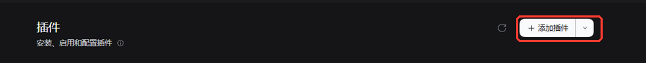
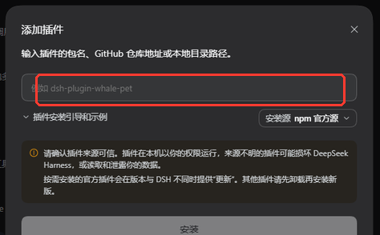
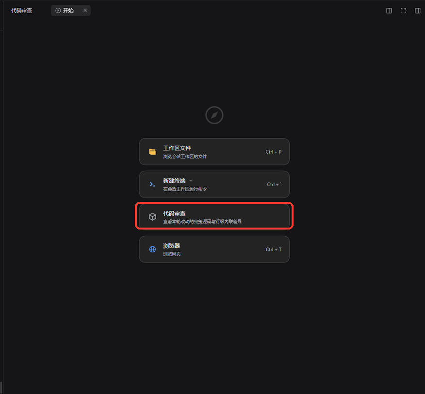

# dsh-review-panel

    
[中文](README.md) · [Issues](https://github.com/sadgsk/dsh-review-panel/issues)

## What is this

`dsh-review-panel` brings a **Cursor-style code review experience** to DeepSeek Harness. It adds a read-only **Code Review** tab to the official right sidebar, showing what changed in this agent turn, in the uncommitted worktree or in any historical git version as full source files with line-level inline diffs — and it brings the **VS Code shortcuts** you already know.

DSH's builtin review shows one hunk at a time; this panel gives you the **whole file** — added lines tinted across the full row, deleted lines kept inline with their original line numbers — plus a file tree, editor tabs and keyboard-driven navigation, so reviewing feels like working in an editor.

- **Full source + inline line-level diffs** — added lines tinted, deleted lines inline with original line numbers
- **Four diff baselines** — `Agent turn` / `Git uncommitted` / `Any git version` / `Code only`, switchable in one click
- **Diff against any git version** — pick any historical commit (or type a branch, tag, `HEAD~2`, …) and review exactly what that commit changed; switch to "changes since this version" to see the cumulative diff up to the current worktree. Especially handy for reviewing the last round right after pushing
- **VS Code-style workspace** — file tree, editor tabs, Quick Open (`Ctrl+P`), command palette, workspace search
- **Language-server navigation** — `F12` definition, `Shift+F12` references, hover, document outline, read-only diagnostics
- **Read-only by design** — never writes files, never runs git mutations, never installs anything silently
- **Follows the DSH light/dark theme automatically**

## 🆕 What's New

### v0.3.1 · Historical git diffs

You can now review changes against **any historical git version** right inside the Code Review page:

- **Diff against any git version** — the baseline dropdown now offers **Latest commit** and **Git version…**. Pick any commit, branch, tag or revision expression such as `HEAD~2` and review exactly what it changed with full source and line-level inline diffs; switch to **Changes since this version** to see the cumulative diff from that version up to the current worktree. Especially handy for reviewing the last round right after pushing.
- **Language-server navigation works on historical versions** — `F12` go-to-definition, `Shift+F12` references, hover and the document outline all work on the snapshot; a cross-file jump opens the target file at that version. (Diagnostics stay hidden there so an old snapshot is never mixed with the current worktree; they come back on the worktree baselines.)
- **Your review workspace survives session switches** — switch to another conversation or sidebar tab and come back: the open files, active tab and selected diff baseline (including the picked git version) are still there.

> Full history: [commits/main](https://github.com/sadgsk/dsh-review-panel/commits/main).

## Install

Requires **DSH 0.2.1-rc.2** or newer (Desktop and Web both work). Git and language servers are optional; the panel degrades gracefully without them.

### 1. Open the Plugins page

Open **Plugins** in DSH's left sidebar and click **Add plugin** at the top right:

### 2. Paste the repository URL and install

Paste this repository's URL (`https://github.com/sadgsk/dsh-review-panel`) into the input and click **Install**:

### 3. Open Code Review

Restart DSH when prompted. Then click **+** in the right sidebar and choose **Code Review / 代码审查**:

You can also open it from the "本轮修改" pill above the chat input.

## Review changes from a historical git version

The toolbar's baseline dropdown offers more than `Agent turn` and `Git uncommitted` — you can compare against any git version:

- **Latest commit**: one click to review what the most recent commit (`HEAD`) changed. Right after a push, this is exactly the last round's diff.
- **Git version…**: opens the commit history (sha, subject, branch/tag refs and date). After you pick a commit:
  - **This version's diff** (default) — what that commit introduced relative to its previous version (first parent). Works even when the worktree is clean or has moved on.
  - **Changes since this version** — the cumulative diff from that version up to the current worktree (committed, staged, unstaged and untracked changes included).
  - The input below the list also accepts any revision expression (full/short sha, branch, tag, `HEAD~2`, …).

Historical content comes from git. `F12`, find references, hover and the document outline keep working on that snapshot text (a cross-file jump opens the target file at the selected version; its line number comes from the current worktree and may be off); diagnostics stay hidden in this mode so an old snapshot is never mixed with the current project. Worktree baselines restore diagnostics automatically.

## Session switching

The review page remembers each conversation's workspace state: after switching sessions and back, the open files, tabs and diff baseline (including the selected git version) are still there instead of being reset.

## Shortcuts

Every command is registered through DSH's official shortcuts service, so all of them can be rebound in **Settings → General → Keyboard shortcuts**. On macOS, use `Cmd` instead of `Ctrl`; a chord the OS already owns may show as unbound, in which case rebind it in Settings.

| Action | Windows / Linux | macOS |
| --- | --- | --- |
| Open Code Review | `Ctrl+Alt+D` | `Cmd+Option+D` |
| Previous / next change | `Shift+F7` / `F7` | `Shift+F7` / `F7` |
| Quick Open | `Ctrl+P` (fallback `Ctrl+Alt+P`) | `Cmd+P` (fallback `Cmd+Option+P`) |
| Command palette | `Ctrl+Shift+P` | `Cmd+Shift+P` |
| Workspace search | `Ctrl+Shift+F` | `Cmd+Shift+F` |
| Go to line | `Ctrl+G` | `Cmd+G` |
| Next / previous tab | `Ctrl+Tab` / `Ctrl+Shift+Tab` | `Cmd+Tab` / `Cmd+Shift+Tab` |
| Close tab | `Ctrl+F4` | `Cmd+F4` |
| Show / hide file tree | `Ctrl+Shift+E` | `Cmd+Shift+E` |
| Document outline | `Ctrl+Shift+O` | `Cmd+Shift+O` |
| Find in editor | `Ctrl+F` | `Cmd+F` |
| Go to definition | `F12` / `Ctrl+click` | `F12` / `Cmd+click` |
| Find references | `Shift+F12` | `Shift+F12` |
| Fold / unfold block | `Ctrl+Shift+[` / `Ctrl+Shift+]` | `Cmd+Option+[` / `Cmd+Option+]` |
| Fold / unfold all | `Ctrl+K Ctrl+0` / `Ctrl+K Ctrl+J` | `Cmd+K Cmd+0` / `Cmd+K Cmd+J` |
| Font zoom | `Ctrl+wheel` / `Ctrl+=` / `Ctrl+-` / `Ctrl+0` | `Cmd+wheel` / `Cmd+=` / `Cmd+-` / `Cmd+0` |

Navigate back / forward has no default chord; bind it in Settings if you want it.

## Feedback

Found a bug, have an idea, or just want to share how you use it? Please open an [Issue](https://github.com/sadgsk/dsh-review-panel/issues).

## License

[MIT](LICENSE). See [THIRD_PARTY_NOTICES](THIRD_PARTY_NOTICES.md) for third-party components and their licenses.
