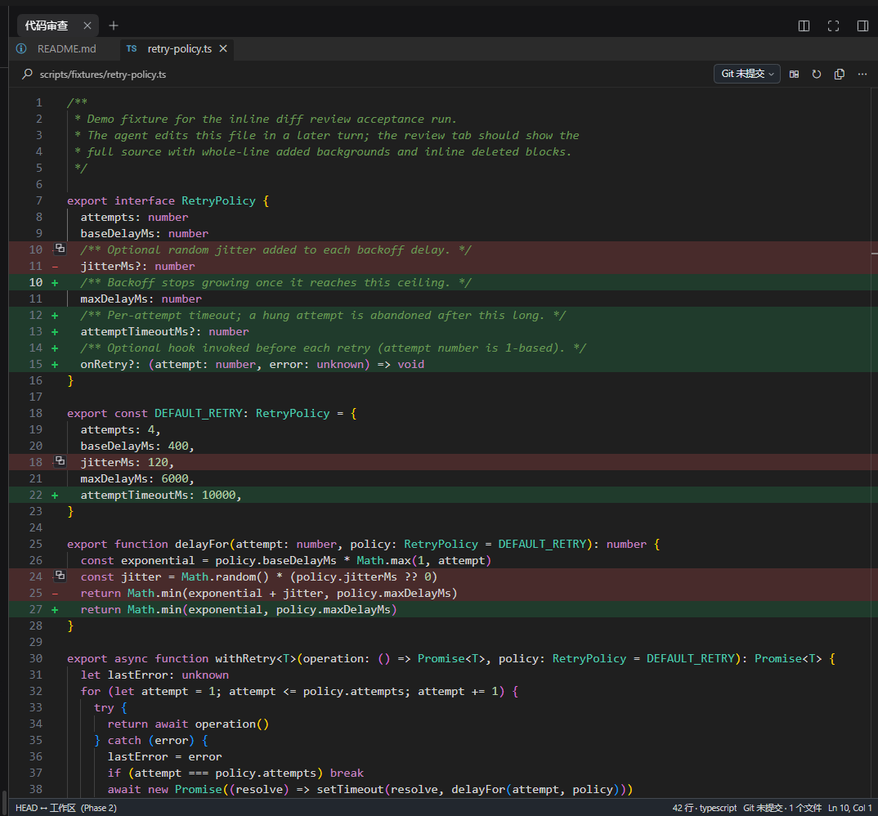
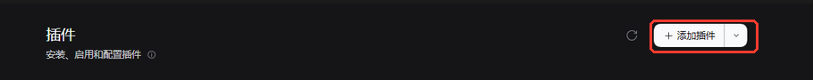
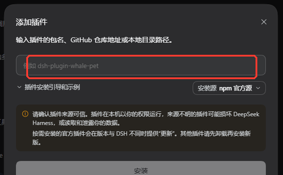
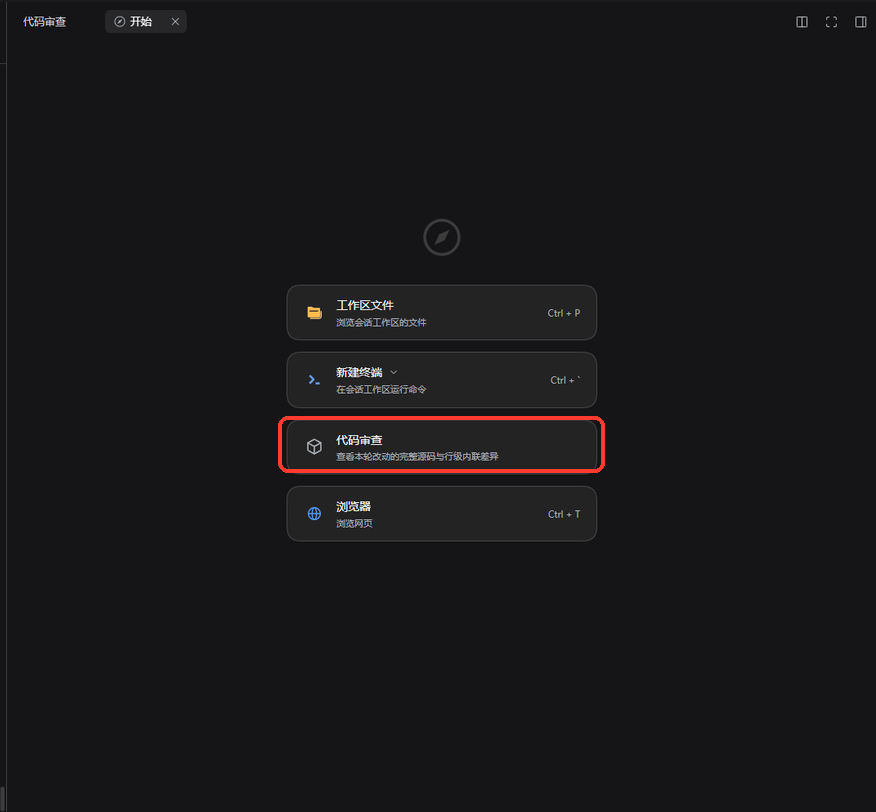

# dsh-review-panel

    
[English](README.en.md) · [Issues](https://github.com/sadgsk/dsh-review-panel/issues)

## 这是什么

`dsh-review-panel` 把 **Cursor 式的代码审查体验**带进 DeepSeek Harness：在官方右侧栏里加一个只读的「代码审查」页，用完整源码 + 行级内联 diff 展示 Agent 本轮、Git 未提交或任意历史版本改了什么，并把常用的 **VS Code 快捷键操作**搬了过来。

DSH 自带的审查是一个个 hunk 片段；这个插件给的是**整个文件**——新增行整行着色，删除行按原行号内联显示，配合文件树、编辑器标签页和键盘操作，像在编辑器里 review 一样。

- **完整源码 + 行级内联 diff**：新增行整行着色，删除行内联保留原行号
- **四种对比基线**：`Agent 本轮` / `Git 未提交` / `任意 Git 版本` / `仅代码`，一键切换
- **任意 Git 版本 diff**：选中任意历史提交（也可输入分支、标签、`HEAD~2` 等版本引用），直接查看那次提交引入的改动；也能切换到「自该版本以来」查看该版本到当前工作区的累计改动。推送之后再回头 review 上一轮改动尤其方便
- **VS Code 式工作区**：文件树、编辑器标签页、Quick Open（Ctrl+P）、命令面板、工作区搜索
- **语言服务导航**：F12 跳转定义、Shift+F12 查找引用、悬停提示、文档大纲、只读诊断
- **只读安全**：不写文件、不提交 Git、不静默安装任何东西；需要操作时交给 DSH Agent
- **自动跟随 DSH 明暗主题**

## 安装

需要 **DSH 0.2.1-rc.2** 或更高版本（Desktop 与 Web 均可）。Git 与语言服务器都是可选项，缺失时自动降级。

### 1. 打开插件页

在 DSH 左侧栏打开 **插件**，点右上角的 **添加插件**：

### 2. 粘贴仓库地址并安装

在输入框里粘贴本仓库地址（`https://github.com/sadgsk/dsh-review-panel`），点 **安装**：

### 3. 打开代码审查

安装完成后按提示重启 DSH。之后在右侧栏点 **+**，选择 **代码审查** 即可：

如果预览入口还没出现，也可以点击聊天输入框上方的「本轮修改」直接打开。

## 查看历史 Git 版本的改动

审查页工具栏上有对比基线下拉菜单，除了 `Agent 本轮` 和 `Git 未提交`，还可以按任意 Git 版本对比：

- **最新提交**：一键查看最近一次提交（`HEAD`）引入的改动。刚 push 完想 review 上一轮时，直接点它即可。
- **Git 版本…**：打开提交历史列表（显示 sha、提交说明、分支/标签与时间）。选中一个提交后：
  - **该版本改动**（默认）：展示该提交相对上一版本（第一父提交）引入的改动，即使工作区已经干净或又有了新提交，也能准确回看那一轮。
  - **自该版本以来**：展示该版本到当前工作区的累计改动，包含已提交、已暂存、未暂存和新增文件。
  - 列表下方的输入框也可以直接输入任意版本引用（完整/短 sha、分支、标签、`HEAD~2` 等）。

历史版本的内容来自 Git：`F12`、查找引用、悬停与文档大纲由语言服务器基于该快照文本工作，跨文件跳转会打开目标文件在当前选中版本中的内容（行号取自工作区当前版本，可能略有偏移）；为避免旧快照与新工作区混用产生误报，该模式下不显示诊断标记。切回工作区相关基线后诊断自动恢复。

## 会话切换

审查页会记住每个会话的工作区状态：切换会话再切回来时，仍停留在之前的文件、标签页与对比基线（包括选中的 Git 版本），不会被重置。

## 快捷键

所有命令都注册在 DSH 官方快捷键服务里，可在 **设置 → 通用 → 键盘快捷键** 中重新绑定。macOS 上把 `Ctrl` 换成 `Cmd`；个别组合被系统占用时会显示为未绑定，此时可在设置里改绑。

| 操作 | Windows / Linux | macOS |
| --- | --- | --- |
| 打开代码审查 | `Ctrl+Alt+D` | `Cmd+Option+D` |
| 上一处 / 下一处改动 | `Shift+F7` / `F7` | `Shift+F7` / `F7` |
| 快速打开文件 | `Ctrl+P`（被占用时 `Ctrl+Alt+P`） | `Cmd+P`（被占用时 `Cmd+Option+P`） |
| 命令面板 | `Ctrl+Shift+P` | `Cmd+Shift+P` |
| 工作区搜索 | `Ctrl+Shift+F` | `Cmd+Shift+F` |
| 跳转到行 | `Ctrl+G` | `Cmd+G` |
| 下一个 / 上一个标签页 | `Ctrl+Tab` / `Ctrl+Shift+Tab` | `Cmd+Tab` / `Cmd+Shift+Tab` |
| 关闭标签页 | `Ctrl+F4` | `Cmd+F4` |
| 显示 / 隐藏文件树 | `Ctrl+Shift+E` | `Cmd+Shift+E` |
| 文档大纲 | `Ctrl+Shift+O` | `Cmd+Shift+O` |
| 编辑器内查找 | `Ctrl+F` | `Cmd+F` |
| 跳转定义 | `F12` / `Ctrl+单击` | `F12` / `Cmd+单击` |
| 查找引用 | `Shift+F12` | `Shift+F12` |
| 折叠 / 展开代码块 | `Ctrl+Shift+[` / `Ctrl+Shift+]` | `Cmd+Option+[` / `Cmd+Option+]` |
| 全部折叠 / 全部展开 | `Ctrl+K Ctrl+0` / `Ctrl+K Ctrl+J` | `Cmd+K Cmd+0` / `Cmd+K Cmd+J` |
| 字号缩放 | `Ctrl+滚轮` / `Ctrl+=` / `Ctrl+-` / `Ctrl+0` | `Cmd+滚轮` / `Cmd+=` / `Cmd+-` / `Cmd+0` |

导航后退 / 前进默认不占用按键，可在设置里自行绑定。

## 反馈

使用中遇到问题、有功能建议，或者想分享使用体验，欢迎提 [Issue](https://github.com/sadgsk/dsh-review-panel/issues)。

## License

采用 [MIT](LICENSE) 许可。第三方组件与对应许可见 [THIRD_PARTY_NOTICES](THIRD_PARTY_NOTICES.md)。
